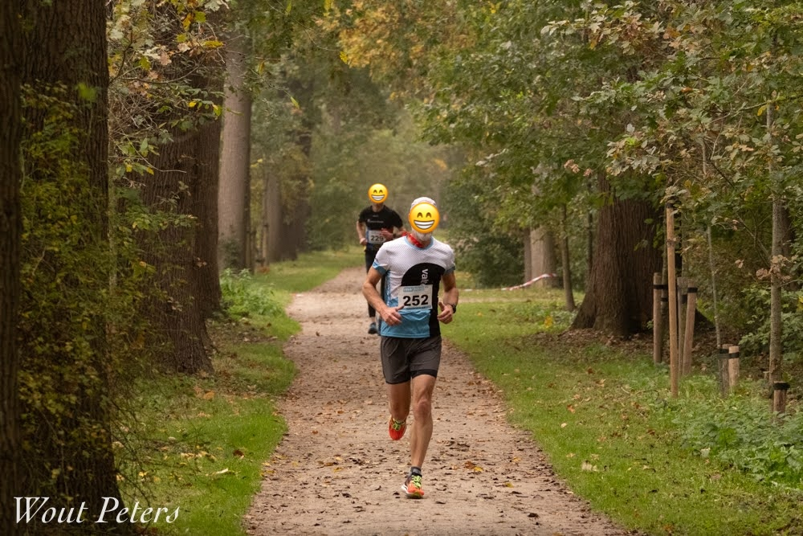

# Hi 👋🏼

This page is my public portfolio as a statistician (to be).

_disclaimer: this page is for the course MLaRPiS purpose only, it doesn't represent me as a professional developer_

## Who am I?

My name is Klaas, a guy from Utrecht, Netherlands. This is me doing what I like doing most:

{fig-align="left" width=33%}

You can also find me on [LinkedIn](https://www.linkedin.com/in/klaasdieleman/).

## What do I do?

Here's a list of things I currently do when not sleeping:

- Working as a full time web developer at an agency. I've been doing this for the past 20 years.
- Acquiring my Master's grade in methods, statistics and data science at [Utrecht University](https://www.uu.nl/en).
- Enjoying my family
- Running
- Visiting concerts
